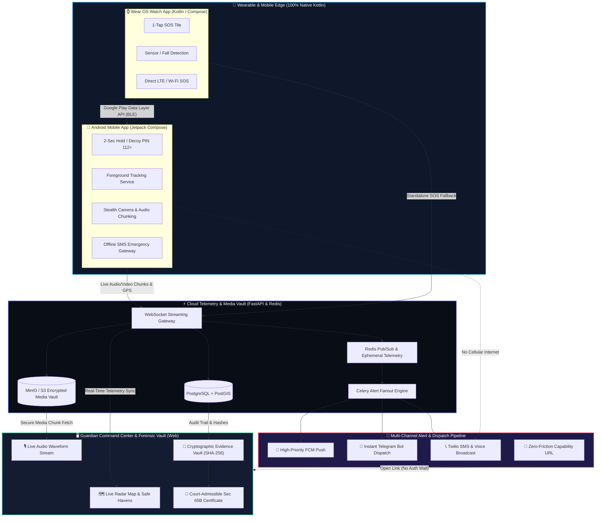
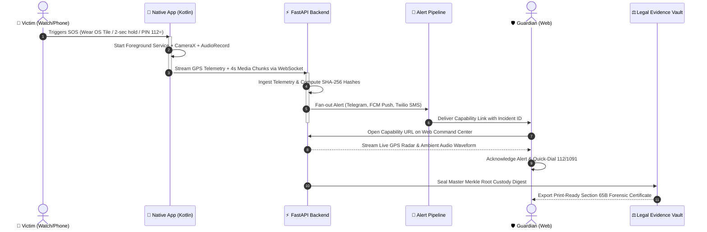

# 🛡️ SafeCircle — Women's Safety Ecosystem & Digital Forensic Vault

<div align="center">

[](https://github.com)
[](https://github.com)
[](https://kotlinlang.org)
[](https://fastapi.tiangolo.com)
[](https://github.com)

**An intelligent, multi-tier personal safety net combining native wearable SOS triggers, stealth black-screen telemetry streaming, and court-admissible cryptographic evidence preservation.**

[Problem Statement](#-problem-statement) • [The Solution](#-the-solution) • [Live Screens](#-screen-gallery--system-walkthrough) • [Tech Stack & Architecture](#-technical-architecture--tech-stack) • [Key Innovations](#-key-innovations--novelty) • [System Workflow](#-end-to-end-system-workflow) • [Quickstart](#-quickstart-guide)

</div>

---

## 🏷️ Tags & Category
`#WomensSafety` `#NativeAndroid` `#Kotlin` `#WearOS` `#JetpackCompose` `#ComputerForensics` `#Section65B` `#BharatiyaSakshyaAdhiniyam` `#FastAPI` `#RealTimeTelemetry` `#EmergencyResponse` `#recHERsion2026`

---

## 🚨 Problem Statement

Women facing unsafe or threatening situations may struggle to discreetly access help, alert trusted contacts, and communicate their location quickly. Existing safety approaches can leave gaps between triggering an emergency alert and coordinating an effective response.

Additionally, incident-related evidence such as audio recordings, screenshots, and digital harassment reports can be difficult to organise and preserve with reliable integrity checks.

SafeCircle addresses these challenges by bringing together discreet emergency access, SOS alerts, safe journey planning, guardian coordination, and evidence management in one connected personal safety platform.

### 🎯 Our Goals

- **Discreet Access:** Make safety features accessible when openly using an app may be difficult.
- **Faster Coordination:** Help trusted contacts receive alerts and coordinate their response.
- **Journey Awareness:** Help users plan journeys and identify potential safe spots.
- **Evidence Organisation:** Keep incident-related media and reports organised, with SHA-256 checks to help detect file changes.
- **Additional Safety Support:** Provide tools such as a fake call simulator, siren, flashlight, and quick access to helplines.

### ⚠️ The Critical Gaps in Existing Solutions

1. **High Friction in Direct Duress:** When assaulted or intimidated, unlocking a smartphone, navigating to an app, and sliding a button is physically dangerous or impossible. Attackers immediately seize phones.
2. **Fragile Network Dependence:** Conventional apps require continuous high-speed cellular internet. If the user enters a basement, elevator, transit tunnel, or low-connectivity area, alerts fail silently.
3. **Absence of Discrete De-escalation:** Users often need a convincing pretext to escape suspicious situations (e.g., predatory cabs, uneasy dates, workplace harassment) before physical violence breaks out.
4. **Legally Inadmissible Digital Evidence:** In online harassment and cyber stalking, victims capture regular screenshots or voice notes. Under the **Indian Evidence Act (Section 65B)** and the **Bharatiya Sakshya Adhiniyam, 2023 (Section 63)**, unverified screenshots are easily contested as fabricated, failing judicial admissibility in court.

---

## 💡 The Solution: SafeCircle Ecosystem

SafeCircle bridges the gap between **instant physical survival** and **uncompromising judicial accountability** through a unified three-tier platform:



1. **Native Wear OS Wrist Trigger (Kotlin + Gradle):** Quick 1-tap SOS complication/tile and biometric/fall sensor triggers. Streams SOS even if the phone remains inside a bag or is snatched away.
2. **Native Android App (Kotlin + Jetpack Compose):** Operates under high-priority Foreground Services. Features stealth camouflaged calculator launch (`112=`), black-screen streaming, realistic fake escape call, audio sirens, offline SMS fallbacks, and safe havens route planning.
3. **SafeCircle Telegram Guardian Bot (Instant Alert Dispatch):** Automated multi-guardian alerting over Telegram. Immediately broadcasts "Physical hold SOS triggered from wearable" along with live Google Maps coordinate links (`https://maps.google.com/?q=lat,lng`) directly to contacts without requiring them to install an app.
4. **Decentralized Guardian Web Portal (React / Next.js):** Zero-friction, capability-URL-authenticated command center for emergency contacts. Displays live GPS telemetry, safe havens radar, audio chunk waveforms, and instant 112/1091 authority dispatch.
5. **Cryptographic Evidence Vault & Judicial Certificate:** Instant client-side SHA-256 hashing and Merkle-tree chain-of-custody sealing. Generates print-ready **Section 65B Electronic Evidence Certificates** with legal citations matching the Indian Penal Code, IT Act 2000, and Bharatiya Nyaya Sanhita (BNS).

---

## 📱 Screen Gallery & System Walkthrough

### 1. Hardware & Companion Integration (Watch + Phone + Telegram Alert Bot)
*Real-time paired physical trigger and automated emergency broadcast tested on live hardware.*

<div align="center">
  <table>
    <tr>
      <td align="center"><b>Wear OS Watch & Android Mobile Sync</b></td>
      <td align="center"><b>SafeCircle Telegram Guardian Bot</b></td>
      <td align="center"><b>Emergency Escape: Realistic Fake Call</b></td>
    </tr>
    <tr>
      <td align="center">
        
      </td>
      <td align="center">
        
      </td>
      <td align="center">
        
      </td>
    </tr>
    <tr>
      <td><b>Wear OS Companion SOS:</b> Physical trigger initiates instant call fanout across trusted circle ("Dad or 2 others") via Wi-Fi/LTE fallback without touching the phone.</td>
      <td><b>Automated Telegram Bot Alerts:</b> Urgent alert broadcast delivered immediately to family/guardians upon wearable SOS with live Google Maps links and continuous location updates.</td>
      <td><b>Discrete De-escalation:</b> Authentic caller screen with customizable incoming timer to gracefully excuse oneself from hazardous encounters.</td>
    </tr>
  </table>
</div>

---

### 2. Native Android Mobile Application (Kotlin + Jetpack Compose)
*Modern Material 3 experience engineered for rapid stress-induced action.*

<div align="center">
  <table>
    <tr>
      <td align="center"><b>1. Home & 2-Second Hold SOS</b></td>
      <td align="center"><b>2. Safe Journey Route & Havens</b></td>
      <td align="center"><b>3. Journey in Progress & Check-in</b></td>
    </tr>
    <tr>
      <td>
        
      </td>
      <td>
        
      </td>
      <td>
        
      </td>
    </tr>
    <tr>
      <td><b>One-Touch Panic Action:</b> Central haptic SOS button, active incident status, quick links to National Helplines (112, 1091), Fake Call, Siren, and Offline SMS.</td>
      <td><b>Safe Haven Navigation:</b> Real-time route planning between origin & destination highlighting verified safe havens, estimated transit time, and contact sharing.</td>
      <td><b>Automated Dead-Man Timer:</b> Live GPS monitoring with scheduled interval check-ins (every 15 min). Triggers automated SOS if check-in is missed.</td>
    </tr>
    <tr>
      <td align="center"><b>4. On-Device Evidence Vault</b></td>
      <td align="center"><b>5. Emergency Deterrent Siren & Strobe</b></td>
      <td align="center"><b>6. Native Android Navigation Bar</b></td>
    </tr>
    <tr>
      <td>
        
      </td>
      <td>
        
      </td>
      <td>
        
      </td>
    </tr>
    <tr>
      <td><b>Cryptographic Vault:</b> Categorized local storage (Audio, Video, Screenshots) sealed with incident tracking numbers (`SC-2026-0142`) and SHA-256 hashes.</td>
      <td><b>High-Decibel Siren:</b> Maximum-volume deterrent frequency accompanied by camera flashlight strobe to draw public attention in physical attacks.</td>
      <td><b>Intuitive Navigation:</b> Instant access across Home, Journey tracking, Evidence Vault, and Circle profile settings.</td>
    </tr>
  </table>
</div>

---

### 3. Guardian Web Command Center & Digital Evidence Vault
*Desktop web dashboard for guardians, law enforcement, and court forensic submissions.*

#### A. Live Emergency Command Center
> **Interactive situational awareness:** Real-time victim GPS radar tracking with 4.5m accuracy, live ambient audio playback waveform, quick authority dialer (112 & 1091), and verified event timeline.

<div align="center">
  
</div>

#### B. Cryptographic Evidence Repository & Vault Custody
> **Tamper-evident evidence inspection:** All audio chunks, stealth dash video clips, and harassment screenshots sealed with immutable SHA-256 fingerprints, timestamps, and exhibit identifiers.

<div align="center">
  
</div>

#### C. Certificate of Digital Evidence & Chain of Custody (Section 65B)
> **Court-admissible judicial certificate:** Automatically generated pursuant to Section 65B of the Indian Evidence Act, 1872 and Section 63 of the Bharatiya Sakshya Adhiniyam, 2023. Includes Master Custody Digest, Exhibit inventories, system metadata, and print-ready PDF export for police FIRs and judicial hearings.

<div align="center">
  
</div>

---

## 🛠️ Technical Architecture & Tech Stack

```
├── 📱 Mobile App (Android Native)
│   ├── Language: Kotlin 2.0 (100% Native, Gradle Kotlin DSL)
│   ├── UI Framework: Jetpack Compose (Material You 3 Design)
│   ├── Asynchronous: Coroutines & StateFlow (MVI / Clean Architecture)
│   ├── Camera & Audio: CameraX (Stealth background chunking), AudioRecord API
│   ├── Storage & Security: Room DB with SQLCipher, Android Keystore, BiometricPrompt
│   └── Background: Foreground Service with WAKELOCK and START_STICKY
│
├── ⌚ Smartwatch App (Wear OS Native)
│   ├── Language: Kotlin 2.0 (Gradle Kotlin DSL)
│   ├── UI Framework: Wear OS Compose (Rotary input & curved layouts)
│   ├── Quick Triggers: TileService (1-tap SOS Tile) & ComplicationProviderService
│   ├── Sync: Google Play Services Wearable Data Layer API (DataClient, MessageClient)
│   └── Biometrics: Health Services API (Heart rate anomaly detection & Fall detection)
│
├── 🌐 Guardian Command Center (Web App)
│   ├── Framework: React 19 / Vite / Next.js with TypeScript
│   ├── Styling: Tailwind CSS & Lucide Icons (Dark Command Center aesthetic)
│   ├── Mapping: Leaflet & OpenStreetMap (Pulsing radar & safe haven vector markers)
│   ├── Audio: Web Audio API & WaveSurfer live chunk visualizer
│   └── Legal Engine: Client-side Section 65B PDF generation with printable print styles
│
└── ⚡ Backend & Cloud Infrastructure
    ├── Core Framework: FastAPI (Python 3.12) with Pydantic v2
    ├── Real-Time: WebSockets (Bi-directional telemetry & chunk streaming)
    ├── Task Queue & Alerts: Redis + Celery (High-priority FCM, Telegram Bot, Twilio SMS)
    ├── Database: PostgreSQL + PostGIS (Spatial indexing for Safe Spots)
    └── Object Storage: MinIO / AWS S3 (Chunked encrypted media vaults)
```

---

## ✨ Key Innovations & Novelty

1. **Stealth Black-Screen Streaming:** Operates in complete background stealth, capturing ambient audio and 4-second video chunks even when the screen is powered down or camouflaged behind a working calculator decoy (`112=`).
2. **Dual Watch-Phone Synergy (Native Kotlin):** Hardware-level Wear OS synchronization using Google Play Data Layer API. Allows an immediate SOS trigger from the wrist even if the phone has been snatched, bagged, or is out of physical reach.
3. **Automated Section 65B & BSA Sec 63 Legal Forensics:** Bridges emergency response with judicial accountability. Automatically fingerprints evidence with SHA-256 digests and Merkle chain-of-custody seals, generating court-admissible forensic certificates ready for police FIR filing.
4. **Zero-Friction Capability URL Dispatch:** Guardians receive a secure, time-limited capability link over SMS/Telegram that bypasses login barriers, granting authorized responders immediate situational awareness without delay.
5. **Instant SafeCircle Telegram Guardian Bot:** Zero-setup emergency alerting. When an SOS is triggered from the watch or mobile app, the backend bot instantly broadcasts urgent alert notifications containing clickable live Google Maps telemetry pins (`https://maps.google.com/?q=lat,lng`) to family and trusted contacts directly in Telegram without requiring them to install new apps.

---

## 🔄 End-to-End System Workflow



1. **Duress Trigger:** User triggers SOS via Wear OS Watch Tile, mobile 2-second hold, or stealth calculator PIN (`112=`).
2. **Edge Ingestion & Stealth Capture:** Foreground Service spins up with camera/mic locks, capturing encrypted 4-second chunks and continuous GPS coordinates.
3. **Multi-Channel Alert Fanout:** FastAPI and Celery distribute urgent alerts with high-priority FCM notifications, Telegram bot messages, and SMS fallbacks.
4. **Guardian Situational Awareness:** Guardian opens the link to view the victim's real-time position with 4.5m accuracy, verified safe havens, and live ambient audio.
5. **Immutable Forensic Sealing:** All exhibits are stamped with verifiable SHA-256 hashes, producing a court-admissible certificate under Section 65B of the Indian Evidence Act and Section 63 of the Bharatiya Sakshya Adhiniyam (BSA).

---

## 🌍 Practical Feasibility, Impact & Scalability

- **Real-World Impact:** Closes the gap between panic alerting and emergency action, while drastically improving conviction rates by securing untampered digital evidence at the moment of duress.
- **High-Throughput Scalability:** Stateless FastAPI microservices backed by Redis Pub/Sub ensure low-latency concurrent telemetry streaming across thousands of simultaneous incidents.
- **Offline Resilience:** If cellular data drops, the mobile client falls back to 1-tap localized SMS dispatch containing precise GPS coordinates and emergency contacts.

---

## 🎨 UX & Accessibility Design Principles

- **Stress-Tolerant Haptics:** A 2-second hold-and-release mechanism with vibration cues eliminates accidental triggers while remaining effortless under duress.
- **Command Center Visual Hierarchy:** Built on an intentional dark palette (`#0B1020`) with high-contrast status colors (Emergency Red `#F0525F`, Amber `#E8B65C`, Resolved Teal `#38C6A3`).
- **Dead-Man Check-in Intervals:** Automated safety check-ins (e.g., every 15 minutes) trigger proactive alerts to guardians if the user deviates from route or fails to confirm safety.

---

## 🚀 Quickstart & Startup Guide

Follow these step-by-step instructions to run each component locally.

---

### 1. Prerequisites
- **Python:** 3.10 to 3.12+ (Backend)
- **Node.js:** v18.0.0 or higher & npm (Web portals)
- **Android Studio:** Ladybug (2024.2) or newer with JDK 17 (Native Kotlin App)

---

### 2. Backend Server (FastAPI + WebSockets)
The backend orchestrates real-time telemetry streaming, audio chunk ingestion, and Telegram/FCM alert fan-out.

```bash
# Navigate to backend directory
cd safecircle-backend

# 1. Create and activate a Python virtual environment
# On Windows (PowerShell):
python -m venv .venv
.venv\Scripts\Activate.ps1

# On macOS/Linux:
python3 -m venv .venv
source .venv/bin/activate

# 2. Install dependencies
pip install -r requirements.txt

# 3. Setup environment variables
# On Windows (PowerShell):
Copy-Item .env.example .env
# On macOS/Linux:
cp .env.example .env

# 4. Start the FastAPI development server
uvicorn app.main:app --reload --host 0.0.0.0 --port 8000
```

- **Interactive API Docs (Swagger UI):** [http://localhost:8000/docs](http://localhost:8000/docs)
- **API Health Check:** [http://localhost:8000/health](http://localhost:8000/health)
- **Demo User Telemetry Endpoint:** [http://localhost:8000/api/users/demo](http://localhost:8000/api/users/demo)

> **Optional Telegram Bot Setup:** In `safecircle-backend/.env`, set your `TELEGRAM_BOT_TOKEN` and `TELEGRAM_CHAT_ID` to receive automated live GPS emergency alerts directly on Telegram upon SOS triggers.

---

### 3. Guardian Web Command Center
The desktop situational awareness dashboard for trusted contacts, responders, and court evidence certification.

```bash
# In a new terminal tab:
cd safecircle-guardian

# Install frontend dependencies
npm install

# Start Vite dev server
npm run dev
```

- **Command Center URL:** [http://localhost:5173](http://localhost:5173)
- **Features to explore:** Live radar map, audio waveform stream, Section 65B printable forensic certificate (`/reports`), and live mock chunk simulator.

---

### 4. Native Android App (Kotlin + Jetpack Compose)
The 100% native Android application featuring the 2-second hold SOS, calculator camouflage decoy, fake call simulator, and offline SMS fallback.

#### Using Android Studio (Recommended):
1. Open **Android Studio**.
2. Select **File > Open** (or **Open** from welcome screen).
3. Select the `android/` directory inside this repository (`c:\Users\hp\safe-circle\android`).
4. Wait for Gradle Sync to complete.
5. Select an Android Emulator or connected physical device (Android 8.0+ / API 26+) and click **Run** (`Shift + F10`).

#### Using Command Line (Gradle):
```bash
cd android

# On Windows:
.\gradlew assembleDebug

# On macOS / Linux:
chmod +x gradlew
./gradlew assembleDebug
```
*The compiled debug APK will be located at `android/app/build/outputs/apk/debug/app-debug.apk`.*

---

### 5. Interactive Mobile Web Simulator (Optional)
If you wish to test the mobile UI directly inside your browser:

```bash
# In a separate terminal:
cd app
npm install
npm run dev
```
- **Mobile Simulator URL:** [http://localhost:5174](http://localhost:5174) (or port displayed in terminal)

---

## ⚖️ Legal & Statutory Compliance References

SafeCircle's digital forensic engine maps evidence directly to Indian statutory frameworks:

| Statute | Section | Legal Application in SafeCircle |
|---|---|---|
| **Indian Evidence Act, 1872** | **Section 65B** | Admissibility of electronic records via automated SHA-256 hash certification. |
| **Bharatiya Sakshya Adhiniyam, 2023** | **Section 63** | Modernized electronic evidence standards with tamper-evident audit trails. |
| **Information Technology Act, 2000** | **Section 66E / 67** | Digital voyeurism, privacy violations, and transmission of obscene content. |
| **Bharatiya Nyaya Sanhita, 2023** | **Section 78 / 79** | Stalking, harassment, and word/gesture insulting the modesty of a woman. |

---

<div align="center">
  <b>SafeCircle</b> — <i>Every second matters. Every update counts. Every piece of evidence preserved.</i>
</div>
